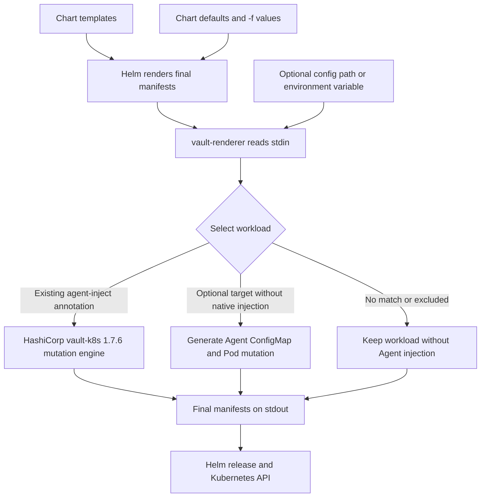
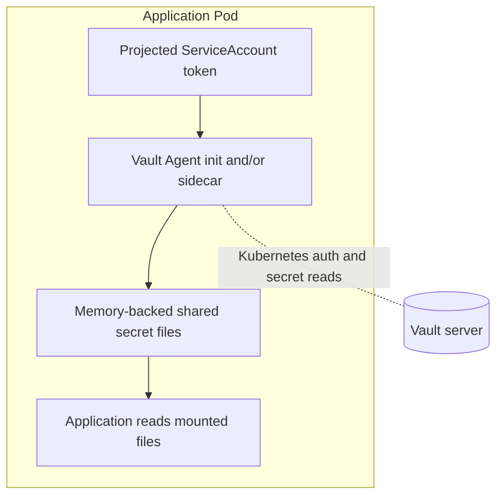

# Architecture

`vault-renderer` runs between Helm rendering and Kubernetes deployment. Its main use case is an existing chart with Vault Agent Injector annotations in an environment where a mutating admission webhook cannot be used. The renderer changes the final manifests before deployment; Vault Agent still retrieves secrets only after a Pod starts.

## 1. From chart to Pod

The renderer inspects Deployments, StatefulSets, DaemonSets, Jobs, CronJobs, and Pods. It reads annotations from each kind's Pod template, or directly from a Pod. By default, `vault.hashicorp.com/agent-inject: "true"` selects a workload. Optional targets can select more workloads. Exclusions and target overrides that set `agent-inject: "false"` prevent injection; a target may explicitly override an existing `"false"` annotation. Other resources pass through.

For an annotated workload, the renderer calls the pinned HashiCorp mutation engine. The Pod gains the requested Agent init container and/or sidecar, volumes, mounts, and a projected ServiceAccount token. Agent instructions and template expressions are carried in the containers' `VAULT_CONFIG` environment value. **This path does not generate a ConfigMap.** The resulting `vault.hashicorp.com/agent-inject-status: injected` annotation lets an installed official injector skip a second mutation.

For a workload selected only by renderer targets, the legacy path generates a deterministic ConfigMap containing Agent HCL and patches the Pod to mount it. The Pod template also carries a configuration checksum. The ConfigMap contains instructions, not retrieved Vault secret values. Repeating an unchanged render produces the same output; a changed Agent configuration updates the checksum and can trigger a rollout.

Helm 3 invokes the executable as a post-renderer. Helm 4 invokes it through the bundled `postrenderer/v1` plugin. Helm 2 has no post-renderer, so the CLI packages rendered output into a new chart. These entry points feed the same manifest transformation.

### Configuration order

| Priority | Source | Effect |
| --- | --- | --- |
| 1, highest | Matching explicit renderer target overrides | Replace supported settings on that workload; exclusions still win. |
| 2 | Annotations in the final Helm-rendered Pod template | Preserve values produced by chart templates and `-f` files. |
| 3 | Optional renderer defaults | Fill settings absent from the final annotations. |

The optional renderer section can be in the same YAML passed to Helm with `-f`. Pass its path separately through `--post-renderer-args=--config=values.yaml` or `VAULT_RENDERER_CONFIG=values.yaml`, because Helm sends manifests, not values files, to a post-renderer. Both paths resolve relative to the directory where Helm is run. A plain values file without `vault-injector` uses annotation-discovery defaults. Under that section, `defaults` and the singular alias `default` are both accepted; use only one.

## 2. Secret retrieval at Pod runtime

Kubernetes starts the mutated Pod. Vault Agent uses the ServiceAccount token to authenticate to Vault, evaluates the configured templates, and writes files into the shared memory-backed volume. The application must already be configured to read those files; the renderer does not rewrite application settings or turn files into process environment variables. An init Agent can populate files before application startup, while a sidecar can refresh them later, according to the selected annotations.

The renderer does not connect to Vault, create Vault roles or policies, or place retrieved secret values in Helm output or generated ConfigMaps. Kubernetes admission and security policies still apply to the final manifests. See the [annotation reference](ANNOTATIONS.md), [rendered examples](README.md#existing-annotations-no-renderer-config), and [local qualification record](QUALIFICATION.md) for supported behavior and test evidence.
